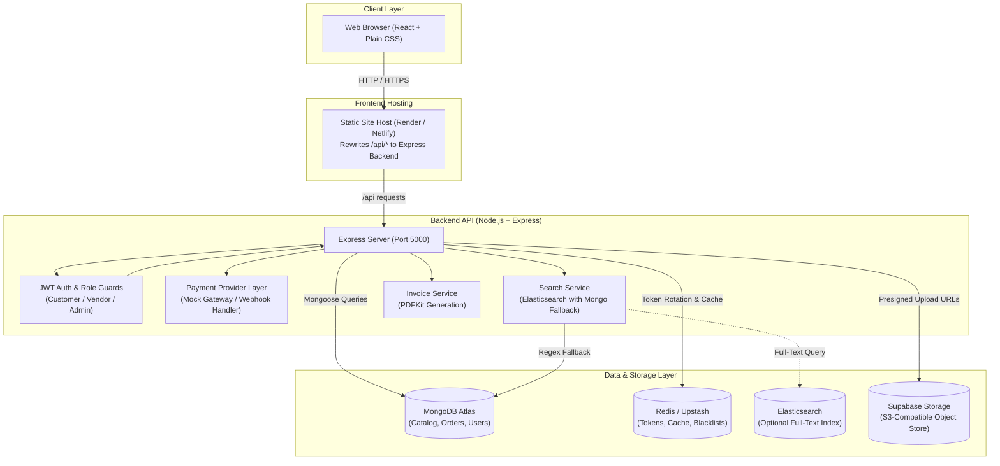

# ShopNest – Multi-Vendor E-Commerce Marketplace

> A modern multi-vendor commerce platform connecting independent brands with shoppers.  
> Enables independent vendors to manage catalog storefronts, customers to purchase in a single checkout, and the platform to automatically orchestrate payment splits and commissions (Internship Project, Full-Stack Track).

```text
[ React 18 ]  [ Vite ]  [ Plain CSS ]  [ Node.js 18+ ]  [ Express ]  [ MongoDB Atlas ]  [ Redis ]  [ Elasticsearch (Optional) ]  [ Supabase Storage ]
```

---

## Live Deployments

- **Web Frontend**: [https://shopnest-web-suju.onrender.com](https://shopnest-web-suju.onrender.com)
- **Backend API Health Check**: [https://shopnest-api-suju.onrender.com/api/health](https://shopnest-api-suju.onrender.com/api/health)

> **Note on Free-Tier Hosting**: The backend is deployed on Render's free tier, which automatically spins down after 15 minutes of inactivity. The first request may take ~50–60 seconds to spin up the container. To improve user experience, the frontend includes a client-side warm-up ping in `main.jsx` that fires immediately when a visitor lands on the site.

---

## Demo Test Accounts

The platform enforces strict role-based access control (RBAC). For local testing or portfolio review, use the accounts below (or register a fresh account):

| Role | Email | Password | Access & Capabilities |
| :--- | :--- | :--- | :--- |
| **Customer** | `<customer-email>` | `<customer-password>` | Browse catalog, search & filter, cart across stores, split checkout, order tracking, product reviews, and PDF invoices. |
| **Vendor 1** | `<vendor1-email>` | `<vendor1-password>` | Vendor Studio, manage store catalog, image uploads, track store sub-orders, update fulfillment status, and view net earnings. |
| **Vendor 2** | `<vendor2-email>` | `<vendor2-password>` | Secondary store account used to test multi-vendor cart grouping, proportional coupon distribution, and split payouts. |
| **Admin** | `<admin-email>` | `<admin-password>` | Approve/reject seller onboarding applications, custom commission rates, manage platform coupons, audit orders, view payout ledger, and analytics dashboard. |

> **Important RBAC Rules**:
> 1. A new account registration is **always** created as a `customer`. The client never sends a `role` attribute.
> 2. Sellers register via the **"Sell"** selector, creating a customer account followed by an onboarding application that requires **Admin approval**.
> 3. Each account has strictly **one** role. Vendors sell; to purchase products, a separate customer account is required.

---

## Screenshots Gallery

> Real visual assets captured from ShopNest live instances. Re-generate this gallery at any time by running `node scripts/generate-readme-gallery.js`.

<!-- SCREENSHOTS:START -->
<details open>
<summary><strong>General Storefront & Platform</strong> (1 screenshot)</summary>

| Screenshot | Screenshot |
| :---: | :---: |
| <br>**Landing page** | &nbsp; |

</details>

<details>
<summary><strong>Customer Shopping Workflow</strong> (5 screenshots)</summary>

| Screenshot | Screenshot |
| :---: | :---: |
| <br>**Check and delivery** | <br>**Customer cart page** |
| <br>**Customer page** | <br>**Invoice page** |
| <br>**Payment gateway** | &nbsp; |

</details>

<details>
<summary><strong>Vendor Studio & Management</strong> (1 screenshot)</summary>

| Screenshot | Screenshot |
| :---: | :---: |
| <br>**Vendor studio** | &nbsp; |

</details>
<!--
Pending capture checklist (24 remaining):
  - [ ] docs/screenshots/general/home-dark.png (Homepage in Dark Mode)
  - [ ] docs/screenshots/general/login.png (Login page split card)
  - [ ] docs/screenshots/general/register-shop-sell.png (Registration with Shop/Sell selector)
  - [ ] docs/screenshots/general/products-search-filters.png (Catalog search & filter controls)
  - [ ] docs/screenshots/general/product-detail.png (Product detail gallery & verified reviews)
  - [ ] docs/screenshots/general/not-found.png (404 Error page)
  - [ ] docs/screenshots/customer/payment-success.png (Payment confirmation & sub-orders)
  - [ ] docs/screenshots/customer/my-orders.png (Customer order history)
  - [ ] docs/screenshots/customer/order-tracking.png (Order tracking timeline per vendor)
  - [ ] docs/screenshots/customer/review-form.png (Product review submission form)
  - [ ] docs/screenshots/customer/become-seller-pending.png (Seller onboarding pending status)
  - [ ] docs/screenshots/vendor/vendor-add-product.png (Add/Edit product modal)
  - [ ] docs/screenshots/vendor/vendor-orders.png (Vendor sub-orders & fulfillment)
  - [ ] docs/screenshots/vendor/vendor-earnings.png (Vendor earnings & platform split)
  - [ ] docs/screenshots/vendor/vendor-store-profile.png (Vendor store profile settings)
  - [ ] docs/screenshots/admin/admin-analytics.png (Admin analytics with pending requests)
  - [ ] docs/screenshots/admin/admin-vendor-approvals.png (Vendor approvals with Accept/Reject)
  - [ ] docs/screenshots/admin/admin-coupons.png (Platform coupon manager)
  - [ ] docs/screenshots/admin/admin-orders.png (Master orders & split payout ledger)
  - [ ] docs/screenshots/admin/admin-payouts.png (Vendor payouts transfer records)
  - [ ] docs/screenshots/mobile/mobile-home.png (Mobile homepage (390px))
  - [ ] docs/screenshots/mobile/mobile-products.png (Mobile catalog with filters (390px))
  - [ ] docs/screenshots/mobile/mobile-cart.png (Mobile multi-vendor cart (390px))
  - [ ] docs/screenshots/mobile/mobile-vendor-orders.png (Mobile vendor orders cards (390px))
-->

<!-- SCREENSHOTS:END -->

## Key Features

### Customer Experience
- **Catalog Discovery**: Search with debounced autocomplete suggestions (300ms), category navigation, price slider, and sorting.
- **Unified Multi-Vendor Cart**: Add products from different vendor storefronts into a single cart. Cart items are cleanly grouped by store with subtotal breakdowns.
- **Proportional Platform Coupons**: Apply platform discount codes with automatic mathematical distribution across vendor sub-orders using the **Largest Remainder Method** to prevent rounding discrepancy.
- **Interactive Sandbox Payment Modal**: Simulated card payment gateway featuring instant pre-filled test cards (Success, Failure, Insufficient Funds, 3DS Timeout) modeled after Razorpay Route.
- **Independent Order Tracking**: Orders split into discrete vendor sub-orders, each with its own shipment progression (`Processing` $\rightarrow$ `Shipped` $\rightarrow$ `Delivered`).
- **Computer-Generated Invoices**: Downloadable PDF invoice (`PDFKit`) containing vendor itemization, tax, and order references.
- **Verified Purchase Reviews**: Customers can submit star ratings and verified text reviews exclusively for products they have purchased and received.

### Vendor Studio
- **Streamlined Store Onboarding**: Prospective sellers register via the "Sell" tab and submit store details for review.
- **Product Catalog Management**: Create, edit, and deactivate products with real-time stock counters, price formatting, and category assignment.
- **Direct Image Uploads**: Product image upload via presigned S3-compatible URLs directly to Supabase Storage with local placeholder fallback.
- **Store Order Fulfillment**: View incoming store orders and transition fulfillment states (`Processing` $\rightarrow$ `Shipped` $\rightarrow$ `Delivered`).
- **Transparent Earnings Tracking**: Review gross revenue, retained 10% platform commission, net vendor payout, and historical transfer records.

### Admin Operations & Governance
- **Vendor Request Approvals**: Dedicated approvals screen displaying pending applications with 44px green Accept and red Reject buttons. Rejection opens a feedback dialog to provide reasons.
- **Commission Split Overrides**: Customize platform commission per vendor (0% to 50%, default 10%).
- **Coupon Lifecycle Engine**: Create flat or percentage discount coupons with minimum order requirements, maximum discount caps, usage limits, and expiration dates.
- **Platform Analytics**: Track net turnover, platform commission, completed order counts, average order value, top-selling vendors, and interactive SVG timeseries charts.
- **Pending Application Notifications**: Automatic count badges in the admin navbar and user menu that poll every 60s while active.

---

## Technology Stack

| Layer | Technology | Purpose & Implementation Details |
| :--- | :--- | :--- |
| **Frontend Framework** | **React 18 + Vite** | Fast SPA with React Router v6, context-driven auth (`AuthContext`), and cart state (`CartContext`). |
| **Frontend Styling** | **Plain CSS with Design Tokens** | Hand-crafted CSS design system (`index.css`) utilizing CSS variables (`--color-*`), dark mode support (`:root[data-theme="dark"]`), and zero external UI/icon packages. |
| **Backend Runtime** | **Node.js (v18+) + Express** | REST API with modular controllers, services, validator middleware (`express-validator`), and global error handling. |
| **Database** | **MongoDB Atlas + Mongoose** | Document database with indexed schemas for `User`, `Vendor`, `Product`, `Order`, `Payout`, `Review`, and `Coupon`. |
| **Cache & Tokens** | **Redis (Upstash / Local)** | Token blacklist revocation on logout, rate limiting, and analytics response caching. |
| **Search Engine** | **Elasticsearch (Optional)** | Full-text fuzzy search and autocomplete suggestions, with automatic fallback to MongoDB regex when disabled. |
| **Object Storage** | **Supabase Storage (S3 API)** | Cloud asset storage for vendor product images via S3-compatible presigned upload URLs (`@aws-sdk/client-s3`). |
| **Payment Gateway** | **Built-in Sandbox Gateway** | Provider-pattern sandbox payment simulation modeled on Razorpay Route with HMAC SHA-256 webhook verification. |
| **Document Generation** | **PDFKit** | Server-side streamed PDF generation for customer tax invoices. |

---

## System Architecture



### Key Architectural Flows

1. **Authentication & Session Continuity**:
   - Access tokens are short-lived (15 minutes) and stored in client memory.
   - Refresh tokens are long-lived (7 days) and stored in secure, `httpOnly`, `SameSite=Lax` cookies.
   - Upon token expiry, Axios interceptors seamlessly request `POST /api/auth/refresh`, rotating both access and refresh tokens.
2. **Multi-Vendor Split Checkout**:
   - The customer places a single unified order paying the total amount.
   - The backend creates one parent `Order` record and splits line items into discrete vendor sub-orders (`vendorOrders`).
   - Platform commission (default 10%) is deducted, and remaining funds are credited to vendor payout records.
3. **Webhook Verification**:
   - The payment gateway sends asynchronous payment outcome events to `/api/payments/webhook`.
   - The endpoint uses `express.raw({ type: '*/*' })` mounted before `express.json()` to verify the raw HMAC SHA-256 signature against `PAYMENT_WEBHOOK_SECRET`.
4. **Resilient Catalog Search**:
   - If `ES_NODE` is configured and available, queries execute via Elasticsearch fuzzy matching.
   - If Elasticsearch is offline or omitted, search automatically falls back to MongoDB regex queries without downtime.

---

## Design Decisions

- **Supabase Storage (S3 API) instead of AWS S3**: AWS account activation required credit verification not feasible during student internship setup. Supabase S3-compatible API was approved by the internship evaluation team. Switching to standard AWS S3 requires only updating `.env` keys.
- **Built-in Sandbox Gateway instead of Live Razorpay**: Production Razorpay Route requires registered enterprise business documentation and bank account verification. The platform implements an internal sandbox gateway following Razorpay's request/response shape, HMAC webhook signature, and transfer models. Connecting a live gateway requires adding one adapter file ([`docs/payments.md`](docs/payments.md)).
- **Vendor-Funded Proportional Coupons**: Discounts are funded by vendor sales; platform commission is calculated on the net discounted subtotal.
- **Paise Currency Precision**: All currency values are calculated and stored as integer paise (e.g. ₹99.50 = `9950`) to eliminate floating-point rounding errors.
- **Role Isolation**: Strictly one role per account. A vendor account cannot be used for customer checkout, protecting payout isolation.

---

## Database Collections & API Endpoints

### Core Database Collections
- `User`: Accounts, credentials (bcrypt), role (`customer`, `vendor`, `admin`).
- `Vendor`: Store name, description, logo URL, approval status (`pending`, `approved`, `rejected`), commission rate.
- `Product`: Title, price in paise, description, images, category, inventory, rating cache.
- `Order`: Customer ID, address, totals, payment status, array of vendor sub-orders.
- `Payout`: Vendor earnings, commission retained, net payout, disbursement status.
- `Review`: Verified buyer product reviews with 1–5 star ratings.
- `Coupon`: Platform promotional discount codes, validity dates, usage counters.

### Main API Routes

| Area | Method | Endpoint | Access | Purpose |
| :--- | :--- | :--- | :--- | :--- |
| **Auth** | `POST` | `/api/auth/register` | Public | Register customer account. |
| **Auth** | `POST` | `/api/auth/login` | Public | Authenticate user, receive JWT & cookie. |
| **Auth** | `POST` | `/api/auth/refresh` | Public | Rotate refresh token and update access token. |
| **Products** | `GET` | `/api/products` | Public | Search catalog with filters, sort, and pagination. |
| **Products** | `GET` | `/api/products/suggest` | Public | Autocomplete suggestions. |
| **Cart** | `GET`, `POST` | `/api/cart` | Customer | Manage customer shopping cart. |
| **Orders** | `POST` | `/api/orders` | Customer | Initiate multi-vendor checkout order. |
| **Orders** | `GET` | `/api/orders/:id/invoice` | Customer/Admin | Stream computer-generated PDF invoice. |
| **Payments** | `POST` | `/api/payments/verify` | Customer | Verify transaction signature. |
| **Payments** | `POST` | `/api/payments/webhook` | Internal/Gateway | Handle HMAC verified payment webhook. |
| **Vendor** | `POST` | `/api/vendors/apply` | Customer | Submit vendor onboarding application. |
| **Vendor** | `GET` | `/api/vendor/products` | Vendor | Manage vendor store inventory. |
| **Vendor** | `GET` | `/api/vendor/orders` | Vendor | View and fulfill store sub-orders. |
| **Vendor** | `GET` | `/api/vendor/earnings` | Vendor | View earnings and payout disbursements. |
| **Admin** | `GET` | `/api/admin/vendors` | Admin | List vendor applications with status filters. |
| **Admin** | `PATCH` | `/api/admin/vendors/:id/approve` | Admin | Approve seller application and upgrade role. |
| **Admin** | `PATCH` | `/api/admin/vendors/:id/reject` | Admin | Reject seller application with feedback reason. |
| **Admin** | `GET` | `/api/admin/stats/pending` | Admin | Return pending vendor request count for badges. |
| **Admin** | `GET` | `/api/admin/analytics` | Admin | Aggregate platform revenue, orders & timeseries. |

---

## Testing & Quality Assurance

The platform includes comprehensive automated test suites and linters:

```bash
# Run backend test suite
npm --prefix backend test

# Run frontend linting
npm --prefix frontend run lint

# Verify frontend production build
npm --prefix frontend run build

# Verify screenshot inventory
node scripts/check-screenshots.js
```

### Backend Test Coverage
- `auth.test.js`: Registration, password validation, role enforcement, JWT generation, token rotation.
- `cart-order.test.js`: Multi-vendor cart grouping, out-of-stock guards, sub-order splitting.
- `payment.test.js`: Payment verification, sandbox provider simulations, HMAC webhook verification.
- `vendor-product.test.js`: Product CRUD, vendor ownership isolation, admin approval/rejection.
- `extras.test.js`: Review verified buyer eligibility, coupon math, PDF invoice streaming, admin analytics, and pending stats count.
- `health.test.js`: Health checks and dependency status.

---

## Running Locally

### Prerequisites
- **Node.js**: v18.0.0 or higher
- **MongoDB**: Local MongoDB instance or free MongoDB Atlas URI
- **Redis**: Local Redis server or free Upstash Redis instance
- **Docker** *(Optional)*: To run local Redis, MongoDB, or Elasticsearch containers

### 1. Clone Repository
```bash
git clone https://github.com/Itachi210-cmd/Multi-Vendor-E-Commerce-Marketplace.git
cd Multi-Vendor-E-Commerce-Marketplace
```

### 2. Configure Backend Environment
Copy the example environment configuration:
```bash
cp backend/.env.example backend/.env
```
Update `backend/.env` with your local or Atlas connection strings:
```ini
PORT=5000
NODE_ENV=development
CLIENT_URL=http://localhost:5173
MONGO_URI=mongodb://127.0.0.1:27017/marketplace
REDIS_URL=redis://127.0.0.1:6379
JWT_ACCESS_SECRET=your_super_secret_access_key_min_32_chars
JWT_REFRESH_SECRET=your_super_secret_refresh_key_min_32_chars
PAYMENT_WEBHOOK_SECRET=your_sandbox_webhook_secret_key
# S3 / Supabase Storage (Optional for local placeholder mode)
S3_ENDPOINT=https://your-project-id.supabase.co/storage/v1/s3
S3_REGION=us-east-1
S3_ACCESS_KEY_ID=your_supabase_access_key
S3_SECRET_ACCESS_KEY=your_supabase_secret_key
S3_BUCKET=marketplace-products
```

### 3. Configure Frontend Environment
```bash
cp frontend/.env.example frontend/.env
```
Ensure the API URL points to your local backend:
```ini
VITE_BACKEND_URL=http://localhost:5000
```

### 4. Install Dependencies
```bash
npm --prefix backend install
npm --prefix frontend install
```

### 5. Seed Database
```bash
# Seed initial admin account
npm --prefix backend run seed:admin

# Seed approved vendor accounts
npm --prefix backend run seed:vendors

# Seed demo product catalog across vendors
npm --prefix backend run seed:demo
```

### 6. Start Development Servers
Run backend in one terminal:
```bash
npm --prefix backend run dev
```
Run frontend in a second terminal:
```bash
npm --prefix frontend run dev
```
Open [http://localhost:5173](http://localhost:5173) in your browser.

---

## Deployment

Refer to [`docs/deployment.md`](docs/deployment.md) for step-by-step production setup:
- **Frontend**: Render Static Site (with `/api/*` rewrites to backend).
- **Backend**: Render Web Service (Node.js runtime).
- **Database**: MongoDB Atlas M0 cluster.
- **Cache**: Upstash Redis (Serverless).
- **Object Storage**: Supabase Storage S3 API.
- **Search**: Optional Elastic Cloud instance (or automated MongoDB fallback).

---

## Known Limitations & Future Work

- **Live Payment Gateway**: Production requires connecting a live gateway (Razorpay Route or Stripe Connect) once formal business registration is available.
- **Transactional Emails**: Email dispatches (order receipts, seller approval notices) currently write to server logs; integrating SendGrid or Amazon SES is planned.
- **Free-Tier Cold Starts**: Addressed by the client-side warm-up ping, though migrating to a persistent compute instance eliminates initial latency entirely.

---

## Project Structure

```text
Multi-Vendor-E-Commerce-Marketplace/
├── backend/
│   ├── scripts/              # Seed scripts (seedDemo.js, seedAdmin.js, seedVendors.js)
│   ├── src/
│   │   ├── config/           # Database, Redis, S3, and Elasticsearch configuration
│   │   ├── controllers/      # Route controllers (auth, cart, order, payment, vendor, admin)
│   │   ├── middleware/       # Auth guards, role checks, rate limiters, validation
│   │   ├── models/           # Mongoose schemas (User, Vendor, Product, Order, Payout, etc.)
│   │   ├── routes/           # Express route definitions
│   │   └── services/         # Business logic (order splitting, coupons, search, payouts)
│   └── tests/                # Automated Jest test suites
├── frontend/
│   ├── src/
│   │   ├── api/              # Axios instance and token refresh interceptors
│   │   ├── components/       # Shared UI components (Navbar, Footer, Modal, Banners)
│   │   ├── constants/        # Brand and platform constants
│   │   ├── hooks/            # Custom React hooks (useAuth, useCart, useTheme)
│   │   ├── pages/            # View pages (Home, Products, Cart, Checkout, Vendor, Admin)
│   │   ├── store/            # Context providers (AuthContext, CartContext, ThemeContext)
│   │   └── index.css         # Plain CSS design tokens and responsive stylesheets
├── docs/
│   ├── screenshots/          # Application screenshot assets
│   │   ├── general/
│   │   ├── customer/
│   │   ├── vendor/
│   │   ├── admin/
│   │   ├── mobile/
│   │   └── CHECKLIST.md      # Screenshot capture specifications and checklist
│   ├── deployment.md         # Production deployment documentation
│   └── payments.md           # Payment gateway architecture and sandbox documentation
└── scripts/
    └── check-screenshots.js  # Node.js screenshot inventory audit utility
```

---

## Author & Contact

- **Author**: Sujal Kate
- **Repository**: [https://github.com/Itachi210-cmd/Multi-Vendor-E-Commerce-Marketplace](https://github.com/Itachi210-cmd/Multi-Vendor-E-Commerce-Marketplace)
- **Track**: Full-Stack Development Internship Project
