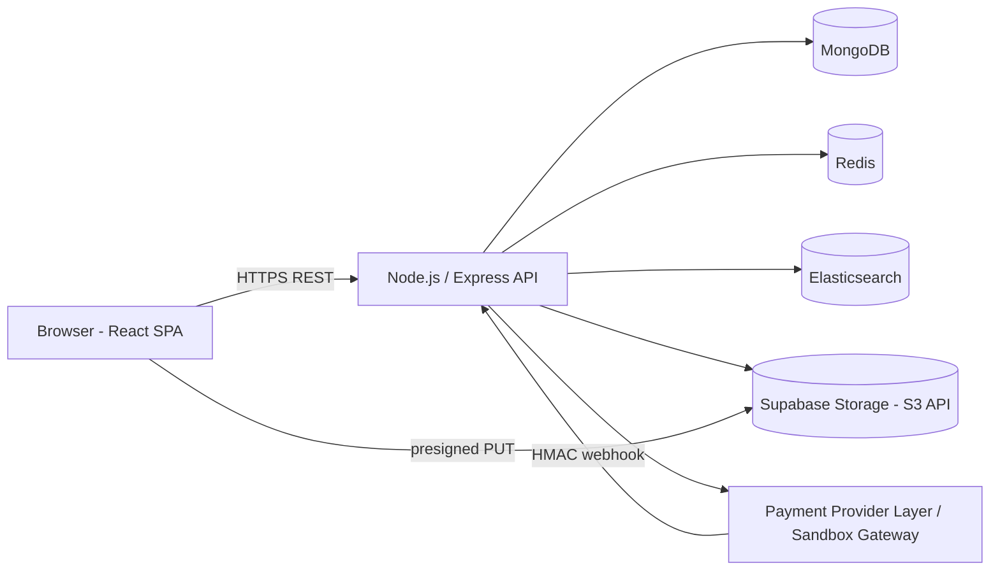

# Multi-Vendor E-Commerce Marketplace — Project Document

**Track:** Full-Stack Development  
**Timeline:** Start 20 Oct 2026 · Deadline 20 Nov 2026  
**Stack:** React + React Router + Context API + plain CSS with design tokens · Node.js (Express) · MongoDB · Elasticsearch · Redis · Supabase Storage through its S3-compatible API (AWS S3 replaced, approved by the internship team) · Built-in sandbox gateway behind a provider layer modelled on Razorpay Route (see docs/payments.md)

---

## 1. Overview

An Amazon/Meesho-style marketplace where **vendors** list and sell products, **customers** browse and buy, and the **platform** collects payments, splits them between vendors, and keeps a commission.

---

## 2. PRD (Product Requirements)

### 2.1 Goals
- Let multiple vendors run independent stores on one platform.
- Give customers fast search, a smooth cart/checkout, and order tracking.
- Automatically split each payment between vendors and the platform (commission).
- Give admin full control and visibility (approvals, coupons, analytics).

### 2.2 Non-goals (out of scope)
- Real money payments (simulated sandbox test mode only)
- Real shipping/courier integration (status is updated manually by the vendor)
- Mobile app, multi-currency, multi-language
- Returns/refund automation beyond basic admin-triggered refund

### 2.3 User Roles
| Role | What they can do |
|---|---|
| **Customer** | Register/login, search products, cart, checkout, track orders, download invoice, review delivered products |
| **Vendor** | Apply for a store, get approved, manage products, view and update own sub-orders, see own earnings |
| **Admin** | Approve/reject vendors, set commission, manage coupons, view platform analytics, manage users |

### 2.3.1 User Stories (key ones)
- As a customer, I can search "shoes" and filter by price/category so I find items quickly.
- As a customer, I can buy from 3 different vendors in a single checkout.
- As a customer, I can only review a product after it is delivered.
- As a vendor, I can upload product images and see only my own orders.
- As a vendor, I can move an order through packed → shipped → delivered.
- As an admin, I can approve a vendor before they can sell.
- As an admin, I can see revenue, commission earned, and top vendors.

### 2.4 Functional Requirements
| ID | Requirement | Priority |
|---|---|---|
| FR1 | JWT auth (access + refresh) with role-based access control | Must |
| FR2 | Vendor application + admin approval | Must |
| FR3 | Product CRUD with multiple images stored via Supabase Storage (S3-compatible API) | Must |
| FR4 | Search with filters (category, price, rating) and sorting via Elasticsearch | Must |
| FR5 | Cart stored in Redis | Must |
| FR6 | Checkout with stock validation and coupon support | Must |
| FR7 | Order lifecycle: placed → packed → shipped → delivered (per vendor sub-order) | Must |
| FR8 | Split payment + commission via built-in sandbox gateway (modeled on Razorpay Route, see `docs/payments.md`) | Must |
| FR9 | Reviews (only for delivered orders, one per user per product) | Must |
| FR10 | Coupons (percent/flat, expiry, usage limit, min order) | Must |
| FR11 | PDF invoice | Must |
| FR12 | Admin analytics dashboard | Must |
| FR13 | Separate deployment of frontend and backend | Must |
| FR14 | Email notifications (order placed, status change) | Nice |
| FR15 | Vendor earnings/payout page | Nice |
| FR16 | Wishlist | Nice |

### 2.5 Non-Functional Requirements
- **Security:** hashed passwords (bcrypt), input validation, rate limiting, helmet, CORS whitelist, HMAC-signed payment & webhook verification
- **Performance:** search results < 300 ms, cart ops < 50 ms (Redis), product pages cached
- **Reliability:** idempotent payment verification, webhook as backup to client verify
- **Maintainability:** modular folders, env-based config, README, API docs (Postman/Swagger)
- **Testing:** unit + API tests on auth, cart, checkout, payment split logic

### 2.6 Success Metrics
- All core steps of the brief working end-to-end on the live deployment
- A full demo flow: vendor onboarded → product listed → customer buys from 2 vendors → payment split correctly → delivered → review → invoice → admin sees analytics
- 70%+ test coverage on core services (auth, cart, order, payment)

---

## 3. Architecture

### 3.1 High-level diagram



### 3.2 Components
| Component | Responsibility |
|---|---|
| **React frontend** | UI for customer, vendor, admin (React + Router + Context API + plain CSS with design tokens; no Tailwind, no Recharts, no UI kit, hand-made SVG charts); Test Gateway modal; plain CSS with water blue theme |
| **Express API** | Business logic, auth, validation, orchestration |
| **MongoDB** | Source of truth (users, vendors, products, orders, reviews, coupons, payouts) |
| **Redis** | Cart, session/refresh token store, product cache, rate limit counters |
| **Elasticsearch** | Product search index (text search, filters, sorting) with MongoDB fallback |
| **Supabase Storage** | Product/vendor images uploaded directly via presigned S3-compatible URLs (Supabase Storage through its S3-compatible API; AWS S3 replaced, approved by the internship team. MinIO is not used.) |
| **Sandbox Payment Gateway** | Collect payment, simulate vendor transfers, retain commission (built-in sandbox gateway behind a provider layer modelled on Razorpay Route; see `docs/payments.md`) |

### 3.3 Key Flows

**Auth:** login → access token (15 min) + refresh token (7 days, stored in Redis) → middleware checks role.

**Image upload:** frontend asks `/uploads/presign` → backend returns signed S3-compatible URL from Supabase Storage → browser uploads directly → URL saved in product.

**Search sync:** product create/update/delete in MongoDB → same operation indexes/updates/removes in Elasticsearch. A `npm run reindex` script rebuilds the index from MongoDB.

**Checkout and payment split:**
1. Customer hits checkout → backend reads cart from Redis, validates stock and coupon.
2. Backend splits items per vendor → builds `subOrders` with `subtotal`, `commission`, `vendorPayout`.
3. Backend creates payment session via Payment Provider Layer (`/api/payments/create-order`).
4. Customer completes payment in the built-in Test Gateway modal (card or UPI).
5. Frontend sends payment details + signature → backend **verifies signature**, marks order paid, reduces stock.
6. Backend creates simulated Route **transfers** to each vendor's account (`vendorPayout`). Remaining amount stays with the platform as commission.
7. Asynchronous HMAC webhook (`/api/payments/webhook`) acts as a safety net if client verification is interrupted.
8. Cart is cleared from Redis.

**Order lifecycle (per sub-order):** `placed → packed → shipped → delivered` (+ `cancelled`). Only the owning vendor (or admin) can advance status. Review is unlocked when a sub-order is `delivered`.

### 3.4 Commission example
Cart ₹1000 = Vendor A ₹600 + Vendor B ₹400, commission 10%.  
Platform ₹100 · Vendor A ₹540 · Vendor B ₹360.

### 3.5 Tech Decisions (short justification)
- **MongoDB:** flexible product attributes per category; nested sub-orders fit naturally.
- **Redis for cart:** fast, TTL-based expiry, no DB writes for abandoned carts.
- **Elasticsearch:** better relevance, fuzzy match, and filtering than Mongo text search.
- **Supabase Storage (S3-compatible API):** AWS S3 was replaced because AWS account verification was not possible (approved by the internship team). MinIO is not used. Presigned URLs allow direct browser-to-bucket uploads with zero backend bandwidth overhead.
- **Sandbox Payment Gateway:** Real gateway test modes (e.g. Razorpay Route live test keys) required formal business registration and merchant KYC (approved by the internship team). A provider-neutral layer with a realistic test gateway simulates order creation, payment capture, HMAC signatures, and automated payout splits (see `docs/payments.md`).

---

## 4. Database Design

```js
users:     { _id, name, email, passwordHash, role: 'customer|vendor|admin', addresses[], createdAt }

vendors:   { _id, userId, storeName, description, logoUrl,
             status: 'pending|approved|rejected',
             commissionPct,
             createdAt }

products:  { _id, vendorId, title, description, price, stock, category,
             tags[], images[], ratingAvg, ratingCount, isActive, createdAt }

orders:    { _id, customerId, orderNumber, shippingAddress,
             items: [{ productId, vendorId, title, price, qty }],
             subOrders: [{ vendorId, items[], subtotal, commission, vendorPayout,
                           status: 'placed|packed|shipped|delivered|cancelled' }],
             couponCode, discount, total,
             payment: { providerOrderId, providerPaymentId, status: 'pending|paid|failed|refunded' },
             createdAt }

reviews:   { _id, productId, customerId, orderId, rating, comment, createdAt }   // unique (productId, customerId)

coupons:   { _id, code, type: 'percent|flat', value, minOrder, maxDiscount,
             expiresAt, usageLimit, usedCount, isActive }

payouts:   { _id, orderId, vendorId, amount, commission, transferId, status }
```

**Indexes:** `users.email` (unique), `products.vendorId`, `products.category`, `orders.customerId`, `orders.subOrders.vendorId`, `coupons.code` (unique).

**Redis keys:** `cart:{userId}` (hash, TTL 7d) · `refresh:{userId}:{tokenId}` · `product:{id}` (cache, TTL 5m) · `rl:{ip}` (rate limit).

**Elasticsearch `products` index:** `title` (text), `description` (text), `category` (keyword), `price` (float), `ratingAvg` (float), `vendorId` (keyword), `createdAt` (date).

---

## 5. API List

**Auth**
- `POST /api/auth/register` · `POST /api/auth/login` · `POST /api/auth/refresh` · `POST /api/auth/logout` · `GET /api/auth/me`

**Vendors**
- `POST /api/vendors/apply` · `GET /api/vendors/me` · `PUT /api/vendors/me`
- `PATCH /api/admin/vendors/:id/approve` · `PATCH /api/admin/vendors/:id/reject`

**Products**
- `GET /api/products?q=&category=&minPrice=&maxPrice=&minRating=&sort=&page=&limit=`
- `GET /api/products/:id` · `GET /api/products/suggest?q=`
- `POST /api/products` · `PUT /api/products/:id` · `DELETE /api/products/:id` (vendor, own products only)
- `POST /api/uploads/presign`

**Cart**
- `GET /api/cart` · `POST /api/cart/items` · `PATCH /api/cart/items/:productId` · `DELETE /api/cart/items/:productId` · `DELETE /api/cart`

**Orders and Payments**
- `POST /api/orders/checkout`
- `POST /api/payments/create-order` · `POST /api/payments/verify` · `POST /api/payments/webhook`
- `POST /api/mock-gateway/pay` (sandbox gateway endpoint)
- `GET /api/orders` · `GET /api/orders/:id` · `GET /api/orders/:id/invoice`
- `GET /api/vendor/orders` · `PATCH /api/vendor/orders/:id/status` · `GET /api/vendor/earnings`

**Reviews and Coupons**
- `POST /api/products/:id/reviews` · `GET /api/products/:id/reviews` · `GET /api/products/:id/reviews/eligibility`
- `POST /api/admin/coupons` · `GET /api/admin/coupons` · `PATCH /api/admin/coupons/:id`
- `POST /api/coupons/validate`

**Admin**
- `GET /api/admin/analytics` · `GET /api/admin/users` · `GET /api/admin/orders` · `POST /api/admin/payouts/:id/retry`

---

## 6. Phases

| Phase | Deliverable | Done when |
|---|---|---|
| **1. Planning and setup** | This doc, schema, API list, repo, Docker compose (Mongo, Redis, ES) | `docker compose up` works, both apps boot |
| **2. Auth and RBAC** | Register/login/refresh, role middleware, protected routes in React | Role-based route guard tested |
| **3. Vendor and products** | Vendor apply and approve, product CRUD, Supabase S3 presigned upload | Vendor can list a product with images |
| **4. Search** | Elasticsearch index, sync hooks, filters, sorting, prefix suggestions | Filter + sort + pagination work |
| **5. Cart and orders** | Redis cart, checkout, sub-orders, status flow | Multi-vendor order created, vendor can update status |
| **6. Payments** | Provider-neutral payment layer, sandbox gateway modal, transfer splits, payouts | Test payment splits correctly |
| **7. Extras** | Reviews, coupons (largest-remainder paise distribution), PDF invoice | Review only after delivered; invoice downloads |
| **8. Admin and QA** | Analytics page, tests, bug fixes, seed script (`npm run seed:demo`) | Tests pass, seed data loaded |
| **9. Deploy and docs** | Live deployment, README, payments guide (`docs/payments.md`), demo seed | Public URLs working |

---

## 7. Design

### 7.1 Screens

**Customer:** Home · Search/Listing (filters + sort) · Product detail (images, reviews) · Cart · Checkout · Order history · Order detail (status timeline + invoice) · Login/Register

**Vendor:** Dashboard (sales, pending orders) · My products (list/add/edit) · Orders (update status) · Earnings · Store profile

**Admin:** Analytics (revenue, commission, orders/day, top vendors/products, fulfillment breakdown) · Vendor approvals · Users · Orders · Coupons

### 7.2 UI Guidelines
- **Core Stack:** React + React Router + Context API for state management (`AuthContext`, `CartContext`) + plain CSS with design tokens (`index.css` CSS variables).
- **Styling & UI Kit Rule:** Plain CSS only with design tokens tailored to a clean Water Blue and White aesthetic. Strict rule: no Tailwind, no Recharts, no UI kit or component libraries (no Bootstrap, Material UI, Ant Design, shadcn/ui).
- **Design Tokens:**
  - `--color-primary`: `#0284C7` (Sky 600)
  - `--color-primary-dark`: `#0369A1` (Sky 700)
  - `--color-primary-light`: `#0EA5E9` (Sky 500)
  - `--color-accent`: `#06B6D4` (Cyan 500)
  - `--color-bg`: `#F0F9FF` (Sky 50)
  - `--color-bg-soft`: `#E0F2FE` (Sky 100)
  - `--color-border`: `#BAE6FD` (Sky 200)
  - `--color-surface`: `#FFFFFF`
  - `--color-text`: `#0F172A` (Slate 900)
  - `--color-text-muted`: `#475569` (Slate 600)
- **Charts:** Hand-made plain SVG and CSS charts for admin analytics (revenue line, orders bar chart, fulfillment breakdown). No external chart libraries (no Recharts).
- **Icons & Visuals:** Inline SVG icons only (no icon packages), loading skeletons, empty states, and local `/placeholder.svg` image fallbacks.
- **Layout & Navigation:** Responsive layout with desktop navbar breakpoint at `1100px`. Below 1100px, navigation cleanly collapses into the slide-out mobile drawer. Touch targets maintain a minimum 44px height.
- **Feedback:** Loading skeletons, clear empty states, inline SVG icons, and visible focus rings (`#0EA5E9`).

### 7.2.1 UI Rules for AI Agents
All AI agents working on frontend tasks must strictly adhere to the permanent rules defined in [`AGENTS.md`](../AGENTS.md):
- **Plain CSS Only:** React with plain CSS only. Never install or use Tailwind CSS, Recharts, or any UI/icon/chart library. Translate Stitch utility classes into standard CSS classes in our stylesheets.
- **Preserve Business Logic & Scope:** Never change `backend/`, API calls, auth, contexts, hooks, routing, state, or business logic during UI tasks. Only change JSX structure, `className`, and CSS.
- **Reference vs Source of Truth:** Stitch is for look and layout only. Existing features and real API data are the source of truth (ignore nonexistent Stitch features like escrow, document upload, or fake sample data).
- **Honest Copy & Demo Notice:** No unverified claims (escrow, certified, guaranteed, bank-grade). Keep the simulated payment notice (*"Demo project: payments are simulated in a test gateway, no real money is charged."*) on footer, checkout, and modal.
- **Responsive Adaptations:** Derive mobile from desktop (hamburger menu `< 1100px`, multi-column layouts stack, slide-in drawers for filters, sticky top tab bar for vendor/admin, tables scroll horizontally or become stacked cards `< 768px`, sticky bottom action bar for checkout/product detail, full-width 44px min-height buttons `< 600px`, no horizontal page scroll).
- **Environment & Build Guard:** Demo credentials visible only in DEV mode (`import.meta.env.DEV`). Work on one screen at a time, run `npm run build` in `frontend/` after each task, and list every changed file.

See [`AGENTS.md`](../AGENTS.md) for the complete permanent specification.

### 7.3 Folder Structure

```
marketplace/
├── docker-compose.yml
├── README.md
├── AGENTS.md
├── marketplace-project-doc.md
├── docs/                  # payments.md, s3-setup.md, project doc copy
├── backend/
│   ├── src/
│   │   ├── config/        # env, db, redis, es, s3 (Supabase)
│   │   ├── models/
│   │   ├── routes/
│   │   ├── controllers/
│   │   ├── services/      # business logic (order, payment, search, coupon, invoice)
│   │   ├── middleware/    # auth, role, validate, rateLimit, error
│   │   ├── utils/
│   │   └── app.js / server.js
│   ├── scripts/           # seedAdmin.js, seedVendors.js, seedDemo.js, reindex.js
│   └── tests/
└── frontend/
    └── src/
        ├── api/
        ├── components/
        ├── pages/ (customer, vendor, admin)
        ├── context/       # AuthContext, CartContext
        ├── routes/
        ├── utils/
        └── hooks/
```

### 7.4 Environment variables (backend)
`PORT, MONGO_URI, REDIS_URL, ES_NODE, ES_INDEX, JWT_ACCESS_SECRET, JWT_REFRESH_SECRET, AWS_REGION, AWS_BUCKET, AWS_ACCESS_KEY_ID, AWS_SECRET_ACCESS_KEY, S3_ENDPOINT, S3_FORCE_PATH_STYLE, S3_PUBLIC_URL, PAYMENT_PROVIDER, MOCK_GATEWAY_SECRET, MOCK_WEBHOOK_SECRET, MOCK_WEBHOOK_ENABLED, CLIENT_URL, BACKEND_PUBLIC_URL, ALLOW_DEMO_SEED`

---

## 8. Testing Plan
- **Unit:** commission calculation, largest-remainder coupon discount distribution, stock validations
- **API (Jest + Supertest):** auth, RBAC, product CRUD and boundaries (price 1-1,000,000 INR, stock 0-100,000, title 3-120 chars), checkout, status transitions, review rule
- **Payment:** sandbox card and UPI simulations, signature verification, duplicate webhook idempotency, payout generation
- **Search:** Elasticsearch indexing, fuzzy typo tolerance, category/price/rating facets, MongoDB fallback
- **Demo Seed Data:** `npm run seed:demo` with realistic DummyJSON product data (prices converted by ~x80 to clean INR values)

---

## 9. Deployment

The application is deployed across cloud platforms: Vercel, Render, MongoDB Atlas, Upstash Redis, optional Elastic Cloud trial.

| Component | Target Platform |
|---|---|
| **Frontend** | Vercel |
| **Backend** | Render |
| **MongoDB** | MongoDB Atlas |
| **Redis** | Upstash Redis |
| **Elasticsearch** | Optional Elastic Cloud trial (with MongoDB fallback) |
| **Storage (Images)** | Supabase Storage through its S3-compatible API (AWS S3 replaced, approved by the internship team) |

Checklist: environment variables configured in production dashboards, CORS whitelist set to deployed Vercel domain, Supabase Storage bucket policy set to public read, health check endpoint `/api/health` monitored.

---

## 10. Risks and Mitigation
| Risk | Mitigation |
|---|---|
| Real payment gateway KYC / business barrier | Built-in sandbox gateway behind generic provider layer modeled on Razorpay Route (see `docs/payments.md`); approved by internship team |
| AWS S3 account verification barrier | Replaced with Supabase Storage S3-compatible API; MinIO is not used; approved by internship team |
| Elasticsearch hosting cost/setup | Docker locally, free trial in cloud; robust MongoDB fallback query service in place |
| Mongo and ES go out of sync | Single `searchService` for all writes, plus a `reindex` script (`npm run reindex`) |
| Overselling stock | Atomic `$inc` with `stock >= qty` verification at checkout and payment capture |
| Deadline slip | Focus on core multi-vendor flow first; keep demo seed scripts reproducible |
