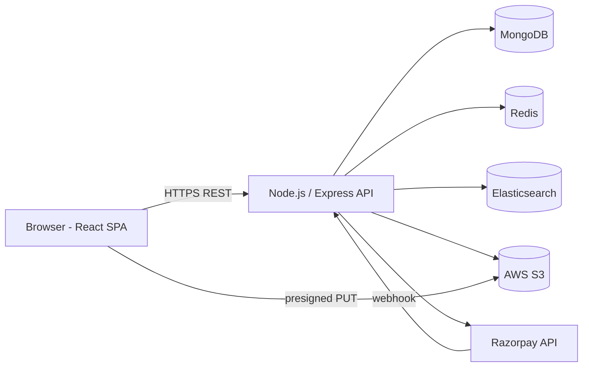

# Multi-Vendor E-Commerce Marketplace — Project Document

**Track:** Full-Stack Development
**Timeline:** Start 20 Oct 2026 · Deadline 20 Nov 2026
**Stack:** React · Node.js (Express) · MongoDB · Elasticsearch · Redis · AWS S3 · Razorpay (Route, test mode)

---

## 1. Overview

An Amazon/Meesho-style marketplace where **vendors** list and sell products, **customers** browse and buy, and the **platform** collects payments, splits them between vendors, and keeps a commission.

---

## 2. PRD (Product Requirements)

### 2.1 Goals
- Let multiple vendors run independent stores on one platform.
- Give customers fast search, a smooth cart/checkout, and order tracking.
- Automatically split each payment between vendors and the platform (commission).
- Give admin full control and visibility (approvals, coupons, analytics).

### 2.2 Non-goals (out of scope)
- Real money payments (test mode only)
- Real shipping/courier integration (status is updated manually by the vendor)
- Mobile app, multi-currency, multi-language
- Returns/refund automation beyond basic admin-triggered refund

### 2.3 User Roles
| Role | What they can do |
|---|---|
| **Customer** | Register/login, search products, cart, checkout, track orders, download invoice, review delivered products |
| **Vendor** | Apply for a store, get approved, manage products, view and update own sub-orders, see own earnings |
| **Admin** | Approve/reject vendors, set commission, manage coupons, view platform analytics, manage users |

### 2.3.1 User Stories (key ones)
- As a customer, I can search "shoes" and filter by price/category so I find items quickly.
- As a customer, I can buy from 3 different vendors in a single checkout.
- As a customer, I can only review a product after it is delivered.
- As a vendor, I can upload product images and see only my own orders.
- As a vendor, I can move an order through packed → shipped → delivered.
- As an admin, I can approve a vendor before they can sell.
- As an admin, I can see revenue, commission earned, and top vendors.

### 2.4 Functional Requirements
| ID | Requirement | Priority |
|---|---|---|
| FR1 | JWT auth (access + refresh) with role-based access control | Must |
| FR2 | Vendor application + admin approval | Must |
| FR3 | Product CRUD with multiple images stored on S3 | Must |
| FR4 | Search with filters (category, price, rating) and sorting via Elasticsearch | Must |
| FR5 | Cart stored in Redis | Must |
| FR6 | Checkout with stock validation and coupon support | Must |
| FR7 | Order lifecycle: placed → packed → shipped → delivered (per vendor sub-order) | Must |
| FR8 | Razorpay Route split payment + commission | Must |
| FR9 | Reviews (only for delivered orders, one per user per product) | Must |
| FR10 | Coupons (percent/flat, expiry, usage limit, min order) | Must |
| FR11 | PDF invoice | Must |
| FR12 | Admin analytics dashboard | Must |
| FR13 | Separate deployment of frontend and backend | Must |
| FR14 | Email notifications (order placed, status change) | Nice |
| FR15 | Vendor earnings/payout page | Nice |
| FR16 | Wishlist | Nice |

### 2.5 Non-Functional Requirements
- **Security:** hashed passwords (bcrypt), input validation, rate limiting, helmet, CORS whitelist, Razorpay signature verification
- **Performance:** search results < 300 ms, cart ops < 50 ms (Redis), product pages cached
- **Reliability:** idempotent payment verification, webhook as backup to client verify
- **Maintainability:** modular folders, env-based config, README, API docs (Postman/Swagger)
- **Testing:** unit + API tests on auth, cart, checkout, payment split logic

### 2.6 Success Metrics
- All 7 steps of the brief working end-to-end on the live deployment
- A full demo flow: vendor onboarded → product listed → customer buys from 2 vendors → payment split correctly → delivered → review → invoice → admin sees analytics
- 70%+ test coverage on core services (auth, cart, order, payment)

---

## 3. Architecture

### 3.1 High-level diagram



### 3.2 Components
| Component | Responsibility |
|---|---|
| **React frontend** | UI for customer, vendor, admin; Razorpay Checkout widget |
| **Express API** | Business logic, auth, validation, orchestration |
| **MongoDB** | Source of truth (users, vendors, products, orders, reviews, coupons, payouts) |
| **Redis** | Cart, session/refresh token store, product cache, rate limit counters |
| **Elasticsearch** | Product search index (text search, filters, sorting) |
| **AWS S3** | Product/vendor images (uploaded directly from browser via presigned URL) |
| **Razorpay Route** | Collect payment, transfer vendor share, retain commission |

### 3.3 Key Flows

**Auth:** login → access token (15 min) + refresh token (7 days, stored in Redis) → middleware checks role.

**Image upload:** frontend asks `/uploads/presign` → backend returns signed S3 URL → browser uploads directly → URL saved in product.

**Search sync:** product create/update/delete in MongoDB → same operation indexes/updates/removes in Elasticsearch. A `npm run reindex` script rebuilds the index from MongoDB.

**Checkout and payment split:**
1. Customer hits checkout → backend reads cart from Redis, validates stock and coupon.
2. Backend splits items per vendor → builds `subOrders` with `subtotal`, `commission`, `vendorPayout`.
3. Backend creates a Razorpay Order (amount = total).
4. Customer pays in Razorpay Checkout.
5. Frontend sends payment id + signature → backend **verifies signature**, marks order paid, reduces stock.
6. Backend creates Route **transfers** to each vendor's linked account (vendorPayout). Remaining amount stays with the platform as commission.
7. Webhook (`payment.captured`) acts as a safety net if the client never calls verify.
8. Cart is cleared from Redis.

**Order lifecycle (per sub-order):** `placed → packed → shipped → delivered` (+ `cancelled`). Only the owning vendor (or admin) can advance status. Review is unlocked when a sub-order is `delivered`.

### 3.4 Commission example
Cart ₹1000 = Vendor A ₹600 + Vendor B ₹400, commission 10%.
Platform ₹100 · Vendor A ₹540 · Vendor B ₹360.

### 3.5 Tech Decisions (short justification)
- **MongoDB:** flexible product attributes per category; nested sub-orders fit naturally.
- **Redis for cart:** fast, TTL-based expiry, no DB writes for abandoned carts.
- **Elasticsearch:** better relevance, fuzzy match, and filtering than Mongo text search.
- **Presigned S3 upload:** server never handles image bytes, so it is cheaper and faster.
- **Razorpay Route:** built for marketplace splits in India.

---

## 4. Database Design

```js
users:     { _id, name, email, passwordHash, role: 'customer|vendor|admin', addresses[], createdAt }

vendors:   { _id, userId, storeName, description, logoUrl,
             status: 'pending|approved|rejected',
             commissionPct,
             razorpayLinkedAccountId,
             createdAt }

products:  { _id, vendorId, title, description, price, stock, category,
             tags[], images[], ratingAvg, ratingCount, isActive, createdAt }

orders:    { _id, customerId, orderNumber, shippingAddress,
             items: [{ productId, vendorId, title, price, qty }],
             subOrders: [{ vendorId, items[], subtotal, commission, vendorPayout,
                           status: 'placed|packed|shipped|delivered|cancelled' }],
             couponCode, discount, total,
             payment: { razorpayOrderId, razorpayPaymentId, status: 'pending|paid|failed|refunded' },
             createdAt }

reviews:   { _id, productId, customerId, orderId, rating, comment, createdAt }   // unique (productId, customerId)

coupons:   { _id, code, type: 'percent|flat', value, minOrder, maxDiscount,
             expiresAt, usageLimit, usedCount, isActive }

payouts:   { _id, orderId, vendorId, amount, commission, razorpayTransferId, status }
```

**Indexes:** `users.email` (unique), `products.vendorId`, `products.category`, `orders.customerId`, `orders.subOrders.vendorId`, `coupons.code` (unique).

**Redis keys:** `cart:{userId}` (hash, TTL 7d) · `refresh:{userId}:{tokenId}` · `product:{id}` (cache, TTL 5m) · `rl:{ip}` (rate limit).

**Elasticsearch `products` index:** `title` (text), `description` (text), `category` (keyword), `price` (float), `ratingAvg` (float), `vendorId` (keyword), `createdAt` (date).

---

## 5. API List

**Auth**
- `POST /api/auth/register` · `POST /api/auth/login` · `POST /api/auth/refresh` · `POST /api/auth/logout` · `GET /api/auth/me`

**Vendors**
- `POST /api/vendors/apply` · `GET /api/vendors/me` · `PUT /api/vendors/me`
- `PATCH /api/admin/vendors/:id/approve` · `PATCH /api/admin/vendors/:id/reject`

**Products**
- `GET /api/products?q=&category=&minPrice=&maxPrice=&minRating=&sort=&page=&limit=`
- `GET /api/products/:id`
- `POST /api/products` · `PUT /api/products/:id` · `DELETE /api/products/:id` (vendor, own products only)
- `POST /api/uploads/presign`

**Cart**
- `GET /api/cart` · `POST /api/cart/items` · `PATCH /api/cart/items/:productId` · `DELETE /api/cart/items/:productId` · `DELETE /api/cart`

**Orders and Payments**
- `POST /api/orders/checkout`
- `POST /api/payments/verify` · `POST /api/payments/webhook`
- `GET /api/orders` · `GET /api/orders/:id` · `GET /api/orders/:id/invoice`
- `GET /api/vendor/orders` · `PATCH /api/vendor/orders/:id/status`

**Reviews and Coupons**
- `POST /api/products/:id/reviews` · `GET /api/products/:id/reviews`
- `POST /api/admin/coupons` · `GET /api/admin/coupons` · `PATCH /api/admin/coupons/:id`
- `POST /api/coupons/validate`

**Admin**
- `GET /api/admin/analytics` · `GET /api/admin/users` · `GET /api/admin/orders`

---

## 6. Phases

| Phase | Deliverable | Done when |
|---|---|---|
| **1. Planning and setup** | This doc, schema, API list, repo, Docker compose (Mongo, Redis, ES) | `docker compose up` works, both apps boot |
| **2. Auth and RBAC** | Register/login/refresh, role middleware, protected routes in React | Role-based route guard tested |
| **3. Vendor and products** | Vendor apply and approve, product CRUD, S3 upload | Vendor can list a product with images |
| **4. Search** | Elasticsearch index, sync hooks, filters, sorting, search UI | Filter + sort + pagination work |
| **5. Cart and orders** | Redis cart, checkout, sub-orders, status flow | Multi-vendor order created, vendor can update status |
| **6. Payments** | Razorpay order, verify, Route transfers, webhook, payouts | Test payment splits correctly |
| **7. Extras** | Reviews, coupons, PDF invoice | Review only after delivered; invoice downloads |
| **8. Admin and QA** | Analytics page, tests, bug fixes, seed script | Tests pass, seed data loaded |
| **9. Deploy and docs** | Live deployment, README, Postman collection, demo video | Public URLs working |

**Buffer tip:** if time gets tight, cut the "Nice" items (email, wishlist) first, never the core flow.

---

## 7. Design

### 7.1 Screens

**Customer:** Home · Search/Listing (filters + sort) · Product detail (images, reviews) · Cart · Checkout · Order history · Order detail (status timeline + invoice) · Login/Register

**Vendor:** Dashboard (sales, pending orders) · My products (list/add/edit) · Orders (update status) · Earnings · Store profile

**Admin:** Dashboard (revenue, commission, orders/day, top vendors/products) · Vendor approvals · Users · Orders · Coupons

### 7.2 UI Guidelines
- React + React Router + a state lib (Redux Toolkit or Zustand) + Axios with interceptors for token refresh
- UI kit: Tailwind CSS (optionally shadcn/ui) for speed and consistent look
- Charts: Recharts for admin analytics
- Responsive layout (mobile-first), loading skeletons, toast notifications, clear empty states
- Protected routes by role (`<RequireRole roles={['vendor']}>`)

### 7.3 Folder Structure

```
marketplace/
├── docker-compose.yml
├── README.md
├── docs/                  # this doc, Postman collection, screenshots
├── backend/
│   ├── src/
│   │   ├── config/        # env, db, redis, es, s3, razorpay
│   │   ├── models/
│   │   ├── routes/
│   │   ├── controllers/
│   │   ├── services/      # business logic (order, payment, search, invoice)
│   │   ├── middleware/    # auth, role, validate, rateLimit, error
│   │   ├── utils/
│   │   └── app.js / server.js
│   ├── scripts/           # seed.js, reindex.js
│   └── tests/
└── frontend/
    └── src/
        ├── api/
        ├── components/
        ├── pages/ (customer, vendor, admin)
        ├── store/
        ├── routes/
        └── hooks/
```

### 7.4 Environment variables (backend)
`PORT, MONGO_URI, REDIS_URL, ES_NODE, JWT_ACCESS_SECRET, JWT_REFRESH_SECRET, AWS_REGION, AWS_BUCKET, AWS_ACCESS_KEY_ID, AWS_SECRET_ACCESS_KEY, RAZORPAY_KEY_ID, RAZORPAY_KEY_SECRET, RAZORPAY_WEBHOOK_SECRET, CLIENT_URL`

---

## 8. Testing Plan
- **Unit:** commission calculation, coupon validation, cart totals
- **API (Jest + Supertest):** auth, RBAC (vendor cannot touch another vendor's product), checkout, status transitions, review rule
- **Payment:** Razorpay test cards, signature verification failure case, duplicate webhook (idempotency)
- **Manual E2E:** full demo flow listed in the success metrics
- **Seed data:** DummyJSON / Fake Store API script for products and reviews

---

## 9. Deployment
| Part | Suggested host |
|---|---|
| Frontend | Vercel or Netlify |
| Backend | Render, Railway, or AWS EC2 |
| MongoDB | MongoDB Atlas (free tier) |
| Redis | Upstash or Redis Cloud (free tier) |
| Elasticsearch | Elastic Cloud trial or Bonsai |
| Images | AWS S3 (+ CORS config for the frontend domain) |

Checklist: env vars set, CORS set to the frontend URL, Razorpay webhook URL pointing to the deployed backend, health endpoint `/api/health`.

---

## 10. Risks and Mitigation
| Risk | Mitigation |
|---|---|
| Razorpay Route linked-account setup is slow/complex | Start the payments phase early; keep a simulated-transfer fallback and document it |
| Elasticsearch hosting cost/setup | Use Docker locally, free trial in cloud; keep Mongo text search as fallback |
| Mongo and ES go out of sync | Single `searchService` for all index writes, plus a `reindex` script |
| Overselling stock | Atomic `$inc` with `stock >= qty` check at payment time |
| Deadline slip | Build the core flow first, polish and Nice-to-haves last |
