# Payment Architecture & Sandbox Gateway Documentation

## 1. Overview & Rationale

During Phase 6 development, live gateway test accounts (such as Razorpay Route or Stripe Connect) required formal business registration, KYC verification, and merchant banking credentials. To ensure rapid, unblocked development while adhering strictly to real-world payment gateway patterns, a **Payment Provider Layer** with a built-in **Sandbox Gateway ("Test Gateway")** was implemented.

This approach was approved by the project evaluation team and provides:
- **Zero Real Money Risk:** Safely simulate realistic e-commerce payments in local and testing environments.
- **Provider-Neutral Design:** Application code and MongoDB models depend exclusively on the generic `BasePaymentProvider` interface rather than any specific vendor SDK.
- **Seamless Production Migration:** Swapping the mock sandbox for Razorpay Route or Stripe Connect requires adding only **one new provider class** without rewriting order, cart, payout, or frontend logic.

---

## 2. End-to-End Payment & Split Architecture

```mermaid
sequenceDiagram
    autonumber
    actor Customer
    participant Frontend as React Frontend
    participant Backend as Express Backend
    participant Provider as Payment Provider Layer
    participant Gateway as Sandbox Gateway
    participant DB as MongoDB & Redis

    Customer->>Frontend: Clicks "Place Order"
    Frontend->>Backend: POST /api/orders/checkout { shippingAddress }
    Backend->>DB: Validate cart in Redis, create Order in MongoDB (payment.status: pending)
    Backend-->>Frontend: Returns created order
    Frontend->>Frontend: Opens "Test Gateway" Sandbox Modal

    Frontend->>Backend: POST /api/payments/create-order { orderId }
    Backend->>DB: Re-check stock & retrieve total (in integer paise)
    Backend->>Provider: createOrder({ orderId, amountPaise })
    Provider-->>Backend: Returns { providerOrderId, amount, currency }
    Backend-->>Frontend: Returns session details

    Customer->>Frontend: Enters test card or UPI details & clicks Pay
    Frontend->>Gateway: POST /api/mock-gateway/pay { providerOrderId, method, card/upi }
    Gateway->>DB: Records transaction in mock_payments (status: captured)
    Gateway-->>Frontend: Returns { order_id, payment_id, signature }

    par Direct Verification
        Frontend->>Backend: POST /api/payments/verify { order_id, payment_id, signature }
        Backend->>Provider: verifyPayment({ order_id, payment_id, signature })
        Backend->>DB: Atomically decrement stock per item (idempotent)
        Backend->>DB: Clear customer cart in Redis
        Backend->>Provider: createTransfer() for each vendor sub-order
        Backend->>DB: Upsert payout records (status: processed)
        Backend-->>Frontend: 200 OK { success: true, order }
    and Asynchronous Webhook
        Gateway--)Backend: POST /api/payments/webhook [Signed HMAC SHA256]
        Backend->>Provider: verifyWebhook(rawBody, signature)
        Note over Backend,DB: Idempotent capture (no-op if already verified)
        Backend--)Gateway: 200 OK { status: 'ok' }
    end

    opt Order Cancellation & Refund
        Customer->>Backend: PATCH /api/orders/:id/cancel
        Backend->>Provider: refund({ paymentId, amountPaise, reverseTransfers: true })
        Backend->>DB: Reverse payouts, restore item stock, mark order refunded
        Backend-->>Customer: 200 OK (Refunded)
    end
```



### Webhook Target URL Resolution
The Sandbox Gateway dispatches signed webhook events using the **`BACKEND_PUBLIC_URL`** environment variable:
- **Default:** `http://localhost:5000` (resolves to `http://localhost:5000/api/payments/webhook`)
- **Configurable:** In remote staging, containerized, or tunneled setups (e.g. Docker network, ngrok, cloud VM), set `BACKEND_PUBLIC_URL=https://api.yourdomain.com` without hardcoded host dependencies.
- **Header:** Sent with `x-webhook-signature` containing HMAC-SHA256 of the raw JSON body signed by `MOCK_WEBHOOK_SECRET`.

---

## 3. Payment Provider Interface (`BasePaymentProvider`)

All payment integrations implement the contract defined in `backend/src/services/payment/payment.interface.js`:

```javascript
export class BasePaymentProvider {
  /**
   * Create an order on the gateway
   * @param {Object} params { orderId, amountPaise, currency, notes }
   * @returns {Promise<{ providerOrderId: string, amount: number, currency: string, provider: string }>}
   */
  async createOrder(params);

  /**
   * Timing-safe verification of payment signature
   * @param {Object} payload { order_id, payment_id, signature }
   * @returns {Promise<{ valid: boolean, error?: string }>}
   */
  async verifyPayment(payload);

  /**
   * Transfer vendor payout to vendor linked account (Route/Connect split)
   * @param {Object} params { paymentId, accountId, amountPaise, notes }
   * @returns {Promise<{ transferId: string, status: 'processed' | 'failed', error?: string }>}
   */
  async createTransfer(params);

  /**
   * Refund payment and reverse transfers
   * @param {Object} params { paymentId, amountPaise, reverseTransfers }
   * @returns {Promise<{ refundId: string, status: 'refunded', error?: string }>}
   */
  async refund(params);

  /**
   * Timing-safe verification of incoming webhook payload and signature
   * @param {Buffer|string} rawBody
   * @param {string} signature
   * @returns {Promise<{ valid: boolean, event?: Object, error?: string }>}
   */
  async verifyWebhook(rawBody, signature);
}
```

---

## 4. Multi-Vendor Payout & Commission Math

- **Paise Precision:** All financial math is computed internally using integer paise (`Math.round(price * 100) * qty`) to prevent JavaScript floating-point inaccuracies.
- **Platform Commission:** Calculated per sub-order as:
  $$\text{commissionPaise} = \text{round}\left(\frac{\text{subtotalPaise} \times \text{commissionPct}}{100}\right)$$
- **Vendor Payout:**
  $$\text{vendorPayoutPaise} = \text{subtotalPaise} - \text{commissionPaise}$$
- **Platform Balance:** The platform retains $\sum \text{commissionPaise}$ while the payment provider automatically routes $\text{vendorPayoutPaise}$ to each vendor's linked account (`acc_mock_xxx` / Razorpay Route linked account).
- **Strict Idempotency:** The `payouts` collection enforces a unique compound index on `(orderId, vendorId)` preventing duplicate payouts even on repeated webhook deliveries or API retries.

---

## 5. Test Credentials & Sandbox Scenarios

The Test Gateway validates card formats via the **Luhn algorithm**, future expiry checking (`MM/YY`), and 3-digit CVV. Card numbers and CVVs are **never logged or persisted in plain text** (only brand and last 4 digits are recorded).

### Test Cards

| Card Number | Expiry | CVV | Scenario Simulated | Expected Outcome |
| :--- | :---: | :---: | :--- | :--- |
| `4111 1111 1111 1111` | Any Future (e.g. `12/28`) | `123` | Successful Payment | `200 OK` (HMAC Signed) |
| `4000 0000 0000 0002` | Any Future (e.g. `12/28`) | `123` | Issuing Bank Decline | `402 PAYMENT_DECLINED` |
| `4000 0000 0000 9995` | Any Future (e.g. `12/28`) | `123` | Insufficient Account Funds | `402 INSUFFICIENT_FUNDS` |
| `4000 0000 0000 0069` | Any Future (e.g. `12/28`) | `123` | Card Expired by Bank | `402 EXPIRED_CARD` |
| *Any with Bad Luhn* | Any | `123` | Checksum Mismatch | `400 Bad Request` |
| *Any Past Expiry* | `01/20` | `123` | Date Validation Error | `400 Bad Request` |

### Test UPI Virtual Payment Addresses (VPA)

| VPA / UPI ID | Scenario Simulated | Expected Outcome |
| :--- | :--- | :--- |
| `success@mock` | Instant UPI capture | `200 OK` (HMAC Signed) |
| `failure@mock` | Bank decline / UPI Timeout | `402 UPI_TRANSACTION_FAILED` |
| *Any other VPA* | Non-existent VPA address | `402 INVALID_VPA` |

---

## 6. How to Plug In a Real Gateway (Razorpay Route or Stripe Connect)

To connect a live gateway, follow these step-by-step instructions:

1. **Create the Provider File:**
   Create `backend/src/services/payment/providers/razorpay.provider.js` extending `BasePaymentProvider`.
2. **Implement the 5 Methods:**
   - `createOrder`: Call `razorpay.orders.create({ amount: amountPaise, currency: 'INR' })`.
   - `verifyPayment`: Use `crypto.createHmac('sha256', keySecret).update(order_id + '|' + payment_id).digest('hex')` with `crypto.timingSafeEqual`.
   - `createTransfer`: Call `razorpay.payments.transfer(paymentId, { transfers: [{ account: accountId, amount: amountPaise, currency: 'INR' }] })`.
   - `refund`: Call `razorpay.payments.refund(paymentId, { amount: amountPaise, reverse_all_transfers: 1 })`.
   - `verifyWebhook`: Verify header `x-razorpay-signature` against `env.razorpay.webhookSecret` and parse body.
3. **Register in Factory:**
   In `backend/src/services/payment/index.js`, register `razorpay: new RazorpayPaymentProvider()`.
4. **Update Environment Variable:**
   In `.env`, set:
   ```env
   PAYMENT_PROVIDER=razorpay
   RAZORPAY_KEY_ID=rzp_live_xxx
   RAZORPAY_KEY_SECRET=xxx
   RAZORPAY_WEBHOOK_SECRET=xxx
   ```
   **Zero application code changes required.**
